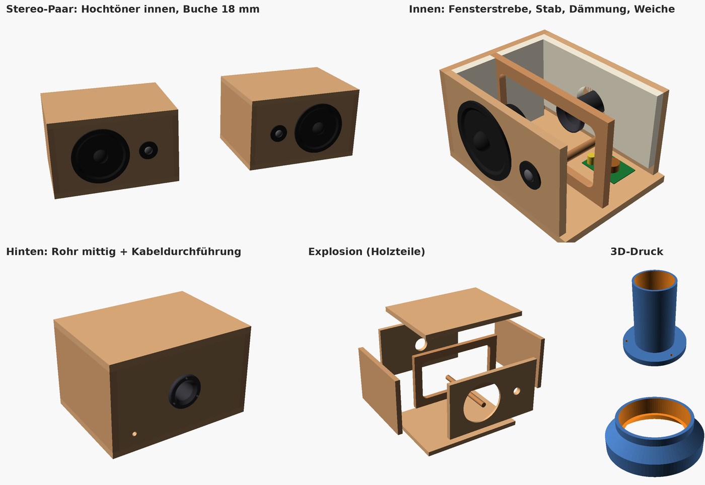

# Lautsprecherboxen aus Buche – Stereo-Paar (2 Stück)

Zwei gleiche Boxen, spiegelbildlich gebaut, mit einem Innenleben, das auf freien Luftfluss
und wenig Eigenresonanz ausgelegt ist.

## Kurzfassung

| | je Box |
|---|---|
| **Anzahl** | **2 Boxen**, spiegelbildlich: Hochtöner jeweils **innen** (zur Mitte) |
| **Holz** | **Buche 18 mm**, am besten als **Buche-Multiplex** (siehe unten) |
| **Außenmaße** | 40 cm breit × 30 cm tief × 25 cm hoch |
| **Innenvolumen** | 20,6 L brutto, **ca. 18,5 L netto** |
| **Chassis** | Tieftöner Ø 18 cm + Hochtöner |
| **Bassreflex** | Rohr **mittig in der Rückwand**, Ø 50 mm, **Trichter an beiden Enden**, ca. **45 Hz** |
| **Deckel** | geschlossen, ohne Ausschnitt |
| **Rückwand** | Kabeldurchführung Ø 12 mm (für eine M12-Kabelverschraubung) |
| **Innen** | Fensterstrebe, Rundstab Front↔Rückwand, Fase hinter dem Tieftöner, Dämmung |
| **Gewicht** | ca. 7 kg Holz |

## Buche – gute Wahl, aber in der richtigen Form

Buche ist hart, schwer und sehr steif, also ein ausgezeichnetes Boxenmaterial (steifer als MDF).
Gut ist eine Boxenwand, wenn sie selbst möglichst *nicht* mitklingt. Die Steifigkeit der Buche hilft genau dabei.

- **Empfohlen: Buche-Multiplex 18 mm.** Die Platte besteht ganz aus verleimten Buchenschichten. Sie ist sehr steif, verzieht sich nicht und reißt nicht, und die gestreiften Kanten sehen schön aus. Erhältlich im Holzfachhandel oder online mit Zuschnitt.
- **Buche-Leimholz 18 mm** (massiv, Baumarkt) geht auch, aber Buche „arbeitet“ stark. Bei wechselnder Luftfeuchte quillt und schwindet sie quer zur Faser um einige Millimeter auf 40 cm. In einer rundum verleimten Box können dann Fugen reißen, und die Box wird undicht. Wenn du Leimholz nimmst:
  1. **Faserrichtung:** Deckel, Boden und Seiten mit der Faser **von vorne nach hinten**, Front und Rückwand mit der Faser **senkrecht**. So arbeiten fast alle Fugen in dieselbe Richtung, nur die vier kurzen senkrechten Kanten nicht.
  2. Die **Fensterstrebe trotzdem aus Multiplex** sägen. Ein Rahmen aus Massivholz würde gegen die Wände arbeiten.
  3. Das Holz vor dem Bau **1–2 Wochen im Raum lagern** und **innen und außen gleich ölen**.

## Das Innenleben – was es bringt

Die Luft in der Box strömt nicht im Kreis, sie **schwingt** im Takt der Musik hin und her. Alles hier
hat ein Ziel: Hinter der Membran und im Rohr soll die Luft frei schwingen können. Wände und
stehende Wellen sollen dagegen ruhig bleiben.

| Maßnahme | Warum |
|---|---|
| **Fensterstrebe** in der Mitte (121 mm hinter der Front), Stege 30 mm, Fensterecken R 20 | Verbindet Deckel, Boden und beide Seiten und halbiert ihre freie Fläche, sodass die Wände kaum mitschwingen. Sie ist zu **~60 % offen**, und die runden Ecken lassen die Luft frei durch, ohne Pfeifen. |
| **Rundstab Buche Ø 20** zwischen Front und Rückwand | Koppelt die beiden Platten, die die Strebe nicht erreicht. Er sitzt neben dem Tieftöner und läuft durch das Fenster der Strebe. |
| **45°-Fase hinter dem Tieftöner-Ausschnitt** (10 mm) | 18 mm Holz hinter der Membran wirken wie ein kurzer Tunnel. Die Fase lässt die Rückseite der Membran frei „atmen“, das gibt weniger Verwirbelung und klarere Mitten. |
| **Trichter an beiden Rohrenden** | Im Rohr strömt die Luft am schnellsten. An scharfen Kanten entstehen Wirbel, man hört es als Schnaufen. Trichter innen und außen verhindern das. |
| **Rohr genau in der Mitte der Rückwand** | Die stärksten stehenden Wellen im Inneren (Breite ≈ 471 Hz, Höhe ≈ 801 Hz) haben genau in der Mitte ihren Druckknoten. Dort nimmt das Rohr sie kaum auf und lässt sie nicht nach außen. |
| **Freiraum vor dem Rohrmund** (≥ 50 mm bis zur Strebe) | Das Rohr braucht vor seiner Öffnung mindestens einen Rohrdurchmesser Platz, sonst wird es gebremst und rauscht. |
| **Dämmung**: Rückwand, Deckel und eine Seite mit **2 cm Schafwolle oder Polyesterwatte** auskleiden, um das Rohr herum aussparen | Die Rückwelle des Tieftöners trifft zuerst auf die Rückwand. Ungedämmt käme sie durch die dünne Membran wieder heraus. Die Dämmung schluckt außerdem die Tiefen-Mode (≈ 650 Hz). **Nicht vollstopfen**, eine Bassreflexbox braucht freie Luft. |
| **Absolut luftdicht** | Jede Undichtigkeit pfeift und kostet Bass. |
| **Weiche auf den Boden**, Kabel festlegen | Nichts darf klappern. Die Weiche sitzt nahe am Kabeleingang und weit weg vom Rohrmund. |
| **Hochtöner innen** (spiegelbildliches Paar) | Die Stereomitte wird schärfer, die Stimme steht genau zwischen den Boxen. |

## Zuschnittliste (für beide Boxen, Buche 18 mm)

Deckel und Boden sind durchgehend. Die Seiten stehen dazwischen, Front und Rückwand sitzen zwischen den Seiten.

| Stück | Anzahl | Maß (mm) |
|---|---|---|
| Deckel / Boden | 4 | 400 × 300 |
| Seitenwände | 4 | 300 × 214 |
| Front / Rückwand | 4 | 364 × 214 |
| Fensterstrebe | 2 | 364 × 214, darin ein Fenster 304 × 154 mit Ecken R 20 (Stege 30 mm) |
| Rundstab Buche Ø 20 | 2 | 264 lang |

Zusammen sind das ca. 1,2 m² Platte. Die Fenster der Streben sägst du mit der Stichsäge aus:
in den Ecken ein 40-mm-Loch bohren und dazwischen gerade sägen.

## Bohrbild (Box „links“)

Alle Maße sind Mittelpunkte, von **vorne** gesehen ab der **linken unteren Außenecke**.
**Für die rechte Box** sind alle x-Maße gespiegelt: **x_rechts = 400 − x**.

| Was | Ø | x links | x rechts | z (von unten) | Platte |
|---|---|---|---|---|---|
| Tieftöner | 155 mm + 45°-Fase innen (10 mm) | 150 | 250 | 125 | Front |
| Hochtöner | 30,2 mm ⚠️ | 300 | 100 | 125 | Front |
| Bassreflexrohr | 57 mm (Lochsäge) | 200 | 200 | 125 | Rückwand |
| Kabeldurchführung | 12 mm | 340 | 60 | 50 | Rückwand |
| Rundstab | Ø 20 | 255 | 145 | 70 | Front ↔ Rückwand (innen) |
| Fensterstrebe | – | – | – | – | Vorderkante 121 mm hinter der Außenfront |

⚠️ Die 30,2 mm stammen aus deiner Skizze. **Vor dem Bohren mit dem Datenblatt des Hochtöners vergleichen.**
Die Kabeldurchführung liegt bei beiden Boxen auf der **Innenseite** (zur Mitte hin), wo meist der Verstärker steht.

## 3D-Druck (je Box 1×, also insgesamt 2× pro Datei)

- `bassreflexrohr.stl`: Flansch + Rohr, 105 mm lang. **Flansch nach unten**, ohne Stützen.
- `trichter_innen.stl`: innerer Trichter zum Aufstecken. **Trichteröffnung nach unten**, ohne Stützen.
- PETG oder PLA, 0,2 mm Schichten, 3 Perimeter, 20 % Infill.
- **Einbau:** Das Rohr von hinten durch das 57-mm-Loch stecken, mit Silikon abdichten und mit 3 Senkkopfschrauben 3,5 × 16 befestigen. Den Trichter durch das Tieftöner-Loch hineinreichen, auf das Rohrende stecken und festkleben (Sekundenkleber oder 2K-Kleber).
- **Abstimmung:** Insgesamt 117 mm (Flansch bis Trichtermund) ergeben **ca. 45 Hz** bei 18,5 L. Willst du sie ändern, das Rohr **vor** dem Aufkleben des Trichters kürzen (kürzer = höher abgestimmt).

> ⚠️ Ob Bassreflex passt, hängt vom Tieftöner ab. Faustregel: **Qts 0,3–0,45** passt zu Bassreflex.
> Ist Qts über ca. 0,5, baust du die Box geschlossen: kein Rohrloch, Rückwand ganz dämmen.

## Hochtöner und Weiche

- **Weiche ist Pflicht**, sonst geht der Hochtöner kaputt. Am einfachsten ist ein bipolarer Folienkondensator (MKT/MKP) vor dem Hochtöner: 4,7 µF bei 8 Ω, 10 µF bei 4 Ω (Trennung bei ca. 4 kHz). Besser ist eine fertige 2-Wege-Weiche (12 dB, 3–4 kHz).
- Der Hochtöner muss **hinten geschlossen** sein. Eine Hochton-Box im eigenen Gehäuse ist das bereits.
- Ist der Hochtöner zu laut, kommt ein Widerstand (2–4 Ω, 5 W) in Reihe davor.
- **Beide Boxen identisch verkabeln** und dabei auf + und − achten, sonst fehlt der Bass.

## Bauablauf

1. **Alle Löcher vorher sägen und bohren**, auch die Fase am Tieftöner-Ausschnitt (Fasenfräser oder Raspel) und das Fenster in der Strebe.
2. **Verbindung:** Holzleim D3 plus **Buchen-Holzdübel 8 × 40** (unsichtbar) oder Spax 4 × 50 mit Buchen-Stopfen über den Schraubenköpfen. In Buche immer vorbohren.
3. **Boden** → **Fensterstrebe** draufleimen (121 mm hinter der Vorderkante) → **Seiten** an Boden und Strebe leimen.
4. **Rückwand** einsetzen. Vorher die Kabelverschraubung montieren und den **Rundstab** von hinten anschrauben und anleimen.
5. **Deckel** aufleimen, auch auf die Strebe.
6. **Weiche** auf den Boden schrauben, Kabel verlegen und festlegen, **Dämmung** einkleben (Sprühkleber oder Tacker), alle Innenfugen mit **Acryl** abdichten.
7. **Front** einleimen. Das Stab-Ende bekommt dabei Leim und drückt gegen die Front.
8. **Rohr** von hinten einsetzen und den **Trichter** durch das Tieftöner-Loch aufkleben.
9. **Ölen** (Hartwachsöl oder Leinölfirnis). Buche wird dadurch warm-honigfarben und dunkelt mit der Zeit nach. Unten Filz- oder Gummifüße anbringen.
10. **Chassis** mit Dichtband einsetzen und mit Spax 4 × 25 festschrauben (vorbohren). Buche hält Schrauben sehr gut.
11. **Dichtigkeitstest:** Rohr zuhalten, die Membran vorsichtig eindrücken und kurz halten. Der Gegendruck muss bleiben.

**Aufstellen:** mindestens **15–20 cm Abstand zur Wand** (das Rohr ist hinten), die Hochtöner zeigen zur Mitte.

## Offene Punkte

- **Hochtöner:** Welches Modell und wie viel Ω? Dann prüfe ich Ausschnitt und Weiche.
- **Tieftöner:** Modell oder Datenblatt (Qts, Vas, Fs). Dann stimme ich Rohrlänge und Volumen genau darauf ab.

## Dateien

- `lautsprecherbox.scad`: parametrisches Modell. `box = "links"` oder `"rechts"`. Ansichten: `zusammenbau`, `paar`, `schnitt`, `explosion`, `rohr`, `trichter`, `front`, `rueckwand`, `strebe`. Zuschnitte, Volumen, Abstimmung und Moden erscheinen in der Konsole.
- `bassreflexrohr.stl`: Druckteil 1 (2× drucken)
- `trichter_innen.stl`: Druckteil 2 (2× drucken)
- `vorschau.png`: Vorschau
