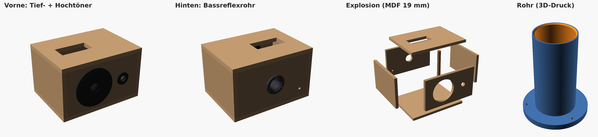

# Lautsprecherbox 40 × 30 cm – 2-Wege: Tieftöner Ø 18 cm + Hochtöner, Bassreflex hinten

Ausgearbeitet nach der Handskizze. Fehlende Maße sind festgelegt, und Holz, Plattenstärke
und Bassreflex sind so gewählt, dass ein typischer 18-cm-Tieftöner (6,5–7") gut klingt.

## Kurzfassung

| | Wert |
|---|---|
| **Holz** | **MDF, 19 mm** (für eine Box, die oft getragen wird oder draußen steht: Birke-Multiplex 18 mm) |
| **Außenmaße** | 40 cm breit × 30 cm tief × **25 cm hoch** |
| **Innenvolumen** | 20,1 L brutto, **ca. 18,5 L netto** |
| **Bestückung** | Tieftöner Ø 18 cm links, **Hochtöner rechts** |
| **Bauart** | Bassreflex, **Rohr in der Rückwand**, Ø 50 mm innen × 120 mm, Abstimmung **ca. 45 Hz** |
| **Versteifung** | 1 Rundholz Buche Ø 25 mm zwischen Deckel und Boden |
| **Gewicht** | ca. 7 kg (MDF) |

## Was in der Skizze stand und was ich festgelegt habe

| Maß | Skizze | Festgelegt |
|---|---|---|
| Breite | 40 cm | 40 cm |
| Tiefe | 30 cm | 30 cm |
| Deckel/Boden | „2 × 30 × 40“ | 2 × 400 × 300 mm |
| **Höhe** | **fehlte** | **25 cm**: Der Ø-18-cm-Korb sitzt mit je 16 mm Rand auf der Front (passt zu deinen „1,5“-Markierungen) und das Volumen liegt mit ~18,5 L im guten Bereich für einen 18-cm-Tieftöner |
| Wandstärke | 1,5 cm | **19 mm** (Begründung unten) |
| Tieftöner | Ø 18 cm, Ausschnitt 155 mm | **links**: Mitte 150 mm von links, mittig in der Höhe |
| Hochtöner | „Ø 30,20 mm“, rechts | **rechts**: Ausschnitt Ø 30,2 mm, Mitte 300 mm von links, gleiche Höhe wie der Tieftöner |
| Bassreflexrohr | „hinten oder oben“ | **hinten**, mittig in der Rückwand (Begründung unten) |
| Schraffiertes Feld auf dem Deckel | ohne Maß | Ausschnitt für das Verstärker-/Bedienmodul, **Platzhalter 150 × 70 mm**, an dein Modul anpassen |
| Rückwand | – | Bohrung Ø 12 mm für die Netzteil-/Klinkenbuchse, 60 mm von links und 60 mm von unten |

## Welches Holz und wie dick?

**Empfehlung: MDF 19 mm.** Das ist der Standard im Boxenbau:

- MDF ist schwer und dicht, schwingt kaum mit und klingt dadurch „trocken“.
- Es ist günstig, im Baumarkt überall erhältlich (mit Zuschnitt) und gleichmäßig ohne Astlöcher.
- Lochsäge, Fräse und Stichsäge schneiden es sauber, und es lässt sich gut lackieren.

**Warum 19 mm und nicht 15 mm?** Deckel und Boden sind innen 36 × 26 cm frei. Bei 15 mm
schwingen so große Flächen hörbar mit (der Bass dröhnt). 19 mm plus die eine Strebe reicht
für ~20 L locker. 22 mm oder mehr macht die Box nur schwerer, ohne dass man es hört. 16 mm
geht zur Not, dann aber mit zwei Streben.

| Material | Eignung | Anmerkung |
|---|---|---|
| **MDF 19 mm** | ⭐⭐⭐ | Beste Wahl für Klang pro Euro. Kanten sind empfindlich, verträgt keine Nässe |
| **Birke-Multiplex 18 mm** | ⭐⭐⭐ | Steifer, robuster und etwas leichter, Schrauben halten besser. Gut für tragbare Boxen, aber ca. 2–3× teurer. Dafür im SCAD `wand = 18` setzen |
| Spanplatte 19 mm | ⭐⭐ | Geht, aber bröselige Kanten und Schrauben halten schlecht |
| Pappel-Sperrholz | ⭐ | Zu weich und leicht, schwingt mit |
| Massivholz / Leimholz | ✗ | Arbeitet mit der Luftfeuchte, Fugen reißen und die Box wird undicht |
| OSB | ✗ | Uneben und undicht, klingt schlecht |

## Zuschnittliste (MDF 19 mm)

Deckel und Boden sind durchgehend. Die Seiten stehen dazwischen, Front und Rückwand sitzen zwischen den Seiten.

| Stück | Anzahl | Maß (mm) |
|---|---|---|
| Deckel / Boden | 2 | 400 × 300 |
| Seitenwände | 2 | 300 × 212 |
| Front / Rückwand | 2 | 362 × 212 |
| Strebe (Rundholz Buche Ø 25) | 1 | 212 lang |

Insgesamt ca. 0,52 m² Platte. Am besten im Baumarkt zuschneiden lassen, das ist genauer als mit der Handkreissäge.

> Bei **Multiplex 18 mm**: Seiten 300 × 214, Front/Rückwand 364 × 214 (rechnet `lautsprecherbox.scad` automatisch).

## Bohrbild

Alle Maße sind Mittelpunkte, gemessen von der **linken unteren Außenecke der fertigen Box**.
Auf der einzelnen Frontplatte (362 × 212) musst du von jedem Maß 19 mm abziehen.

| Was | Ø | x (von links) | z (von unten) | Platte |
|---|---|---|---|---|
| Tieftöner-Ausschnitt | 155 mm | 150 mm | 125 mm | Front |
| Hochtöner-Ausschnitt | 30,2 mm ⚠️ | 300 mm | 125 mm | Front |
| Bassreflexrohr | 57 mm (Lochsäge) | 200 mm (genau mittig) | 125 mm | Rückwand |
| Anschluss | 12 mm | von hinten gesehen 60 mm von der **rechten** Kante | 60 mm | Rückwand |
| Bedienfeld | 150 × 70 mm | Mitte 140 mm | Mitte 150 mm von vorne | Deckel |
| Strebe | Ø 25 | 330 mm | 200 mm von vorne | Deckel ↔ Boden |

⚠️ Die 30,2 mm habe ich aus deiner Skizze übernommen. **Vor dem Bohren mit dem Einbauausschnitt
im Datenblatt deines Hochtöners vergleichen**, denn jeder Hochtöner ist anders.

Den Tieftöner-Ausschnitt **vor dem Zusammenbau** sägen (Stichsäge oder Kreisschneider an
der Oberfräse). Den Ausschnitt am besten mit dem echten Chassis oder dessen Datenblatt
gegenprüfen, denn der Korb muss ringsum mindestens 5 mm aufliegen.

## Hochtöner

- **Geschlossene Rückseite:** Der Hochtöner sitzt im selben Gehäuse wie der Tieftöner. Ist er hinten offen, drückt der Bass seine Membran mit, dann braucht er eine eigene kleine Kammer. Ein Hochtöner im eigenen Gehäuse (Hochton-Box) ist bereits geschlossen und passt.
- **Frequenzweiche ist Pflicht:** Ohne Weiche bekommt der Hochtöner den vollen Bass und geht kaputt. Die einfachste Lösung ist ein **bipolarer Folienkondensator (MKT/MKP)** in Reihe vor dem Hochtöner, kein normaler Elko. Bei 8 Ω nimmst du 4,7 µF, bei 4 Ω 10 µF. Das ergibt jeweils eine Trennung bei ca. 4 kHz. Viele Hochtöner-Gehäuse haben so einen Kondensator schon im Kabel, schau nach.
- **Besser klingt eine fertige 2-Wege-Weiche** (12 dB, ca. 3–4 kHz, passend zur Impedanz). Sie schützt den Hochtöner zuverlässiger und nimmt dem Tieftöner die Höhen ab.
- **Ist der Hochtöner zu laut?** Ein Widerstand (2–4 Ω, 5 W) in Reihe macht ihn leiser.
- **Polung:** Beim Anschließen auf + und − achten. Klingt es dünn, die Polung des Hochtöners testweise tauschen.

## Warum das Rohr hinten und nicht oben?

- Oben sitzt schon das Bedienfeld, und in ein Rohr nach oben fallen Staub, Krümel und Getränke.
- In der Rückwand ist das Rohr unsichtbar, und innen bleibt genug Abstand zu beiden Chassis.
- **Abstand zur Wand:** Die Box mit **mindestens 15–20 cm** Abstand zur Wand aufstellen. Steht sie näher, dröhnt der Bass. Muss sie direkt an der Wand stehen, das Rohr mit einem Schaumstoffstopfen verschließen, dann arbeitet sie wie eine geschlossene Box.
- Oben ginge auch: Im SCAD lässt sich das Rohr versetzen, dann aber nicht über das Bedienfeld oder die Strebe.

## Bassreflexrohr (3D-Druck)

`bassreflexrohr.stl`: 90 × 90 × 120 mm, innen Ø 50 mm, vorne mit einem Trichter (45°), der Strömungsgeräusche verringert.

- **Drucken:** Flansch nach unten aufs Bett, **ohne Stützen**, PLA oder PETG, 0,2 mm Schichten, 3 Perimeter, 20 % Infill
- **Einbau:** von hinten durch das 57-mm-Loch in der Rückwand stecken, mit Silikon oder Heißkleber abdichten und mit 3 Senkkopfschrauben 3,5 × 16 festschrauben
- **Abstimmung:** 120 mm ergeben ca. **45 Hz** bei 18,5 L. Ein **kürzeres** Rohr stimmt **höher** ab (weniger Tiefbass, mehr Punch), ein längeres tiefer. Lieber zu lang drucken und mit der Säge kürzen
- **Alternative ohne Drucker:** HT-Rohr DN 50 aus dem Baumarkt (innen ~46 mm), ca. **100 mm** lang

> ⚠️ **Wichtig:** Die perfekte Abstimmung hängt vom konkreten Tieftöner ab (Thiele-Small-Parameter
> im Datenblatt: Fs, Qts, Vas). Faustregel: **Qts 0,3–0,45 → Bassreflex passt**. Ist Qts über ca. 0,5,
> baust du die Box besser **geschlossen**: kein Loch für das Rohr bohren, sonst bleibt alles gleich.
> Zur Kontrolle eignet sich WinISD oder ein Online-Bassreflexrechner.

## Bau-Tipps

1. **Verleimen:** Holzleim D3 plus Schrauben 4 × 50. Bei MDF **immer vorbohren** (3 mm) und mindestens 3 cm von den Ecken wegbleiben, sonst platzt die Kante. Mit Zwingen pressen.
2. **Reihenfolge:** Boden → Seiten → Rückwand → Strebe → Front → Deckel. Kabel und Dämmung gehen später durch das Tieftöner-Loch und das Bedienfeld rein.
3. **Luftdicht:** Innen alle Fugen mit Acryl abdichten, ebenso die Kabeldurchführung. Unter Tief- und Hochtöner Dichtband kleben. **Test:** Rohr zuhalten, die Membran vorsichtig eindrücken und kurz halten. Der Gegendruck muss bleiben. Gibt die Membran langsam nach, ist die Box irgendwo undicht.
4. **Dämmung:** Rückwand (ums Rohr herum aussparen), eine Seite und den Deckel innen mit 2–3 cm Polyesterwatte (z. B. Sonofil) auskleiden, **nicht vollstopfen**. Vor dem inneren Rohrende ~5 cm frei lassen.
5. **Chassis befestigen:** Mit **Einschlagmuttern M4** statt Holzschrauben, denn MDF-Gewinde nudeln beim zweiten Ausbau aus.
6. **Oberfläche:** Kanten mit 3 mm Radius runden. MDF-Kanten vorher mit Grundierfüller (oder verdünntem Leim) versiegeln, sonst saugen sie den Lack auf. Unten Gummifüße anbringen.
7. **Verstärkermodul:** Von innen gegen den Deckel schrauben und mit einer Dichtung abdichten. Wird es warm, braucht es einen Kühlkörper nach außen.

## Offene Punkte

Diese Stellen in der Skizze konnte ich nicht sicher lesen. Sag Bescheid, dann passe ich das Modell an:

- **„Ø KL …“** (ca. 11,4 mm?): Ist das die Klinken- oder Netzteilbuchse? Im Modell sitzt dafür jetzt eine Ø-12-mm-Bohrung in der Rückwand.
- **Hochtöner:** Welches Modell und welche Impedanz (4 oder 8 Ω)? Dann prüfe ich Ausschnitt und Weiche.
- **Kreuzlinien auf der Seitenwand**: als Versteifung habe ich die Strebe eingebaut. Falls dort ein Griff hin soll, ändere ich das.
- **Modell des Tieftöners und des Verstärkermoduls**: Mit dem Datenblatt kann ich Volumen, Rohrlänge und Bedienfeld genau darauf abstimmen.

## Dateien

- `lautsprecherbox.scad` – parametrisches Modell (OpenSCAD). Ansichten: `zusammenbau`, `explosion`, `rohr`, `front`, `rueckwand`. Zuschnitte, Volumen und Abstimmung erscheinen in der Konsole.
- `bassreflexrohr.stl` – fertige Druckdatei für das Rohr
- `vorschau.png` – Vorschau
